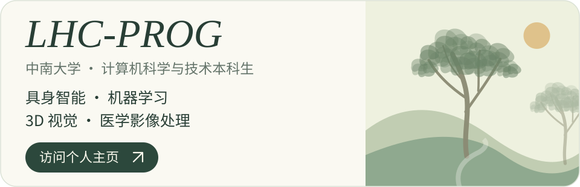
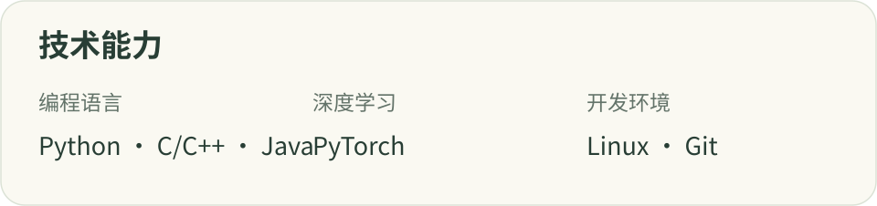
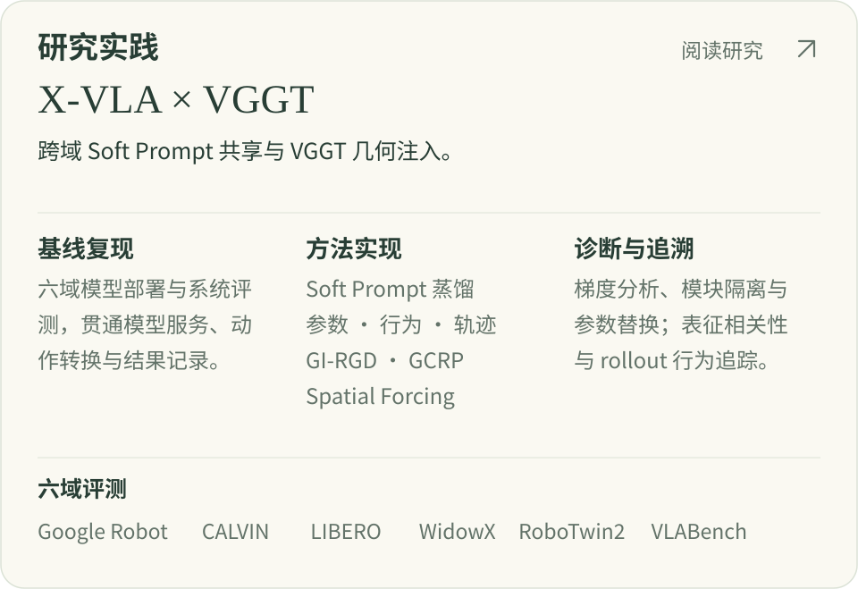
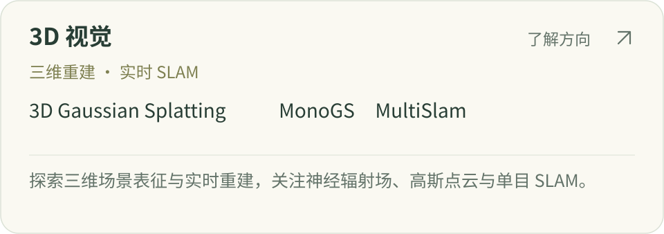
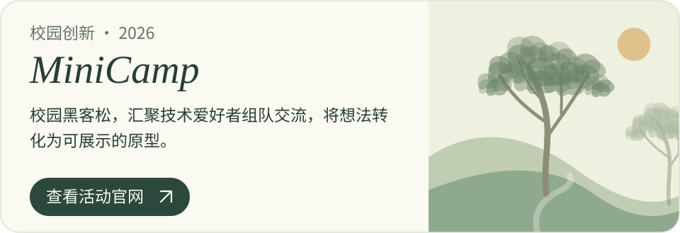

<a href="https://lhc-prog.github.io/" title="LHC-PROG · 中南大学计算机科学与技术本科生。具身智能、机器学习、3D 视觉、医学影像处理。访问个人主页 ↗">
<picture>
  <source media="(max-width:1000px) and (prefers-color-scheme:dark)" srcset="./assets/cards/intro-night-mobile-4fbc74273b.svg">
  <source media="(max-width:1000px)" srcset="./assets/cards/intro-day-mobile-9f82e9cb80.svg">
  <source media="(prefers-color-scheme:dark)" srcset="./assets/cards/intro-night-b20e74d283.svg">
  
</picture>
</a>

<picture>
  <source media="(max-width:1000px) and (prefers-color-scheme:dark)" srcset="./assets/cards/skills-night-mobile-4e6f4b6f98.svg">
  <source media="(max-width:1000px)" srcset="./assets/cards/skills-day-mobile-0974767ce1.svg">
  <source media="(prefers-color-scheme:dark)" srcset="./assets/cards/skills-night-17d6b27de7.svg">
  
</picture>

<a href="https://lhc-prog.github.io/#research" title="研究实践 · X-VLA 跨域 Soft Prompt 共享与 VGGT 几何注入；六域部署、方法实现、诊断与追溯。阅读研究详情 ↗">
<picture>
  <source media="(max-width:1000px) and (prefers-color-scheme:dark)" srcset="./assets/cards/research-night-mobile-1c4fc3fe25.svg">
  <source media="(max-width:1000px)" srcset="./assets/cards/research-day-mobile-3ee70a1a2f.svg">
  <source media="(prefers-color-scheme:dark)" srcset="./assets/cards/research-night-f2e600c573.svg">
  
</picture>
</a>

<a href="https://lhc-prog.github.io/#vision3d" title="3D 视觉 · 三维重建、实时 SLAM、3D Gaussian Splatting、MonoGS、MultiSlam。了解关注方向 ↗">
<picture>
  <source media="(max-width:1000px) and (prefers-color-scheme:dark)" srcset="./assets/cards/vision3d-night-mobile-9a711704a3.svg">
  <source media="(max-width:1000px)" srcset="./assets/cards/vision3d-day-mobile-a8c078a118.svg">
  <source media="(prefers-color-scheme:dark)" srcset="./assets/cards/vision3d-night-0a826289a2.svg">
  
</picture>
</a>

<a href="https://lhc-prog.github.io/#medical-imaging" title="医学影像处理 · 多模态融合、器官分割、病灶检测、图像配准。了解关注方向 ↗">
<picture>
  <source media="(max-width:1000px) and (prefers-color-scheme:dark)" srcset="./assets/cards/medical-night-mobile-0b6ac1407e.svg">
  <source media="(max-width:1000px)" srcset="./assets/cards/medical-day-mobile-2a3401bbea.svg">
  <source media="(prefers-color-scheme:dark)" srcset="./assets/cards/medical-night-3fe26ea905.svg">
  
</picture>
</a>

<a href="https://ttesestt.nanocamp.club/minicamp/" title="MiniCamp 2026 · 校园黑客松，让技术爱好者组队交流，将想法转化为原型。查看活动官网 ↗">
<picture>
  <source media="(max-width:1000px) and (prefers-color-scheme:dark)" srcset="./assets/cards/minicamp-night-mobile-26081c5cd9.svg">
  <source media="(max-width:1000px)" srcset="./assets/cards/minicamp-day-mobile-99dbf2c758.svg">
  <source media="(prefers-color-scheme:dark)" srcset="./assets/cards/minicamp-night-5a9398a2d9.svg">
  
</picture>
</a>

文字介绍

中南大学 · 计算机科学与技术本科生

具身智能 · 机器学习 · 3D 视觉 · 医学影像处理

## 技术能力

Python · C/C++ · Java · PyTorch · Linux · Git

## 研究实践

研究 X-VLA 跨域 Soft Prompt 共享与 VGGT 几何注入，比较参数共享与蒸馏方法，在六域完成模型部署与系统评测。

覆盖六域：Google Robot · CALVIN · LIBERO · WidowX · RoboTwin2 · VLABench

- **基线复现** — 完成 X-VLA 六域部署，贯通模型服务、动作转换与结果记录，建立可复现的评测流程。
- **方法实现** — 实现参数级、行为级与轨迹级 Soft Prompt 蒸馏，以及 GI-RGD、GCRP、Spatial Forcing 几何注入方案；用 PyTorch 搭建训练原型，管理实验版本。
- **诊断与追溯** — 通过梯度分析、模块隔离与参数替换定位异常，结合损失曲线、表征相关性与 rollout 行为交叉诊断，保留配置、结果与失效证据。

## 主要发现

- **共享基线的竞争力** — 简单参数共享（DirectMean）在六域评测中展现竞争力；当前复杂离线蒸馏尚未超越这一基线。
- **几何结构与动作收益** — VGGT 含有超出二维网格的空间结构，但当前通用几何监督尚未稳定改变动作相关表征，也未带来稳定的闭环收益。

## 3D 视觉

三维重建 · 实时 SLAM

3D Gaussian Splatting · MonoGS · MultiSlam

探索三维场景表征与实时重建，关注神经辐射场、高斯点云与单目 SLAM。

## 医学影像处理

分割 · 配准 · 诊断辅助

多模态融合 · 器官分割 · 病灶检测 · 图像配准

关注医学场景中的计算机视觉，探索多模态影像分割、配准与智能分析。

## MiniCamp

MiniCamp 2026。校园黑客松，汇聚技术爱好者组队交流，将想法转化为可展示的原型。

