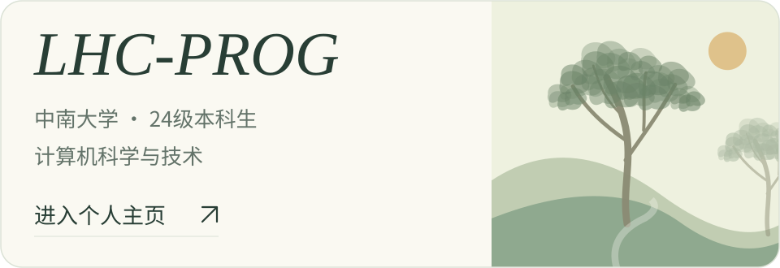

<a href="https://lhc-prog.github.io/" title="LHC-PROG · 中南大学 · 24级本科生 · 计算机科学与技术。点击进入我的个人主页。">
<picture>
  <source media="(max-width:1000px) and (prefers-color-scheme:dark)" srcset="./assets/cards/intro-night-mobile-aa12a3d560.svg">
  <source media="(max-width:1000px)" srcset="./assets/cards/intro-day-mobile-0adf737c54.svg">
  <source media="(prefers-color-scheme:dark)" srcset="./assets/cards/intro-night-45d19f1275.svg">
  
</picture>
</a>

<picture>
  <source media="(max-width:1000px) and (prefers-color-scheme:dark)" srcset="./assets/cards/about-night-mobile-d046df6131.svg">
  <source media="(max-width:1000px)" srcset="./assets/cards/about-day-mobile-65ffba898d.svg">
  <source media="(prefers-color-scheme:dark)" srcset="./assets/cards/about-night-1bf41c2626.svg">
  
</picture>

