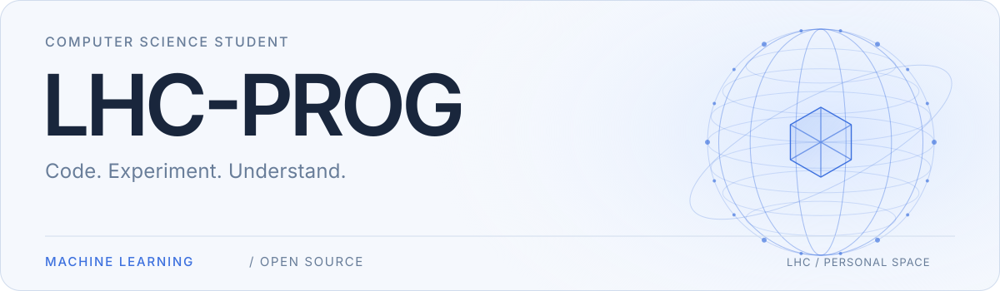

<a href="https://lhc-prog.github.io/">
  <picture>
    <source media="(max-width: 600px) and (prefers-color-scheme: dark)" srcset="./assets/header-dark-mobile.svg">
    <source media="(max-width: 600px)" srcset="./assets/header-light-mobile.svg">
    <source media="(prefers-color-scheme: dark)" srcset="./assets/header-dark.svg">
    
  </picture>
</a>

  <a href="https://lhc-prog.github.io/"><b>个人主页 ↗</b></a>
  &nbsp;&nbsp; · &nbsp;&nbsp;
  <a href="https://ttesestt.nanocamp.club/minicamp/"><b>MiniCamp ↗</b></a>

中南大学 · 计算机科学与技术 · 大三在读

`具身智能` · `机器学习` · `X-VLA` · `PyTorch`

## 研究实践

在课题组参与 **X-VLA** 跨域 Soft Prompt 共享与 **VGGT** 几何蒸馏方向研究。

覆盖基准：`CALVIN` · `LIBERO` · `RoboTwin2` · `VLABench`

- **基线复现** — X-VLA 六域部署与系统性评测，建立完整评测链路
- **方法实现** — Soft Prompt 蒸馏（参数级 · 行为级 · 轨迹级）· GI-RGD · GCRP · Spatial Forcing
- **实验诊断** — 梯度分析 · 模块隔离 · 表征相关性 · rollout 行为追踪

## 技术能力

  
  
  
  
  
  

`Python` · `C/C++` · `Java` · `PyTorch` · `Linux` · `Git`

## 协作实践

**MiniCamp 2026** 校园黑客松 — 统筹 · 宣传 · 现场执行 · 赞助对接

<a href="https://ttesestt.nanocamp.club/minicamp/">
  <picture>
    <source media="(max-width: 600px) and (prefers-color-scheme: dark)" srcset="./assets/minicamp-dark-mobile.svg">
    <source media="(max-width: 600px)" srcset="./assets/minicamp-light-mobile.svg">
    <source media="(prefers-color-scheme: dark)" srcset="./assets/minicamp-dark.svg">
    
  </picture>
</a>
